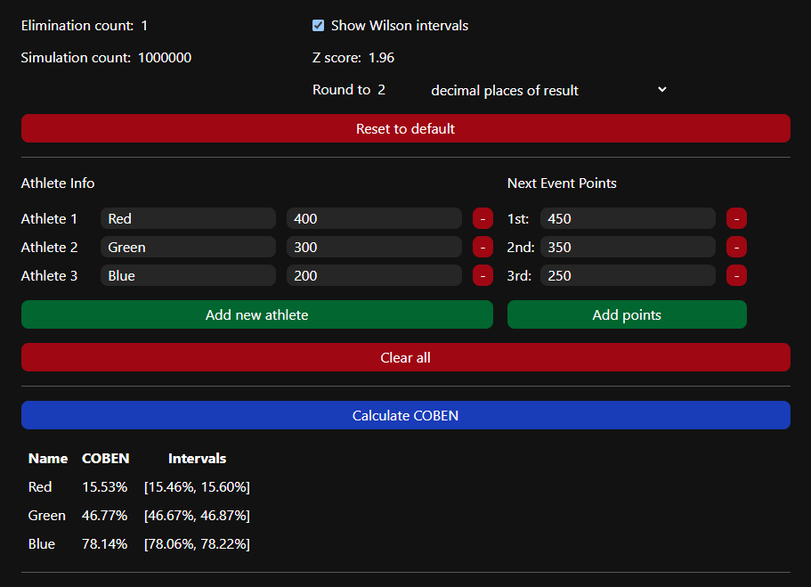

# COBEN Calculator
This tool estimates the Chance Of Being Eliminated Next (COBEN) for athletes in any Algathlon-adjacent competition. The UI was built using [React.js](https://github.com/react/react) and [Tailwind CSS](https://github.com/tailwindlabs/tailwindcss).

## Background

An Algathlon consists of multiple events. After each event, the athletes participating are awarded with points based on their position in the event. Typically, the athlete with the lowest number of points is eliminated, though it is also possible for multiple eliminations to happen after an event. COBEN calculation is done using the Monte Carlo method. A certain number of simulations are carried out (the default here is 1 million). In each simulation, the points are randomly assigned to each athlete. The COBEN is the number of simulations where an athlete was eliminated divided by the number of total simulations, expressed as a percentage.

Read more information [here](https://doc671.web.app/coben/info).

## Usage

Enter the athletes' names, their current point values and the points to be given after the next event. There are additional options to alter the number of eliminations, number of simulations, rounding mode and whether to show uncertainties (Wilson intervals).

## Credits
- [Cary Huang](https://github.com/carykh) for creating Algathlons in the first place, and for the original COBEN calculator in Processing.
- [C Ezra M](https://github.com/C-Ezra-M) for creating an improved COBEN calculator, which has a number of additional features I've re-implemented here.
